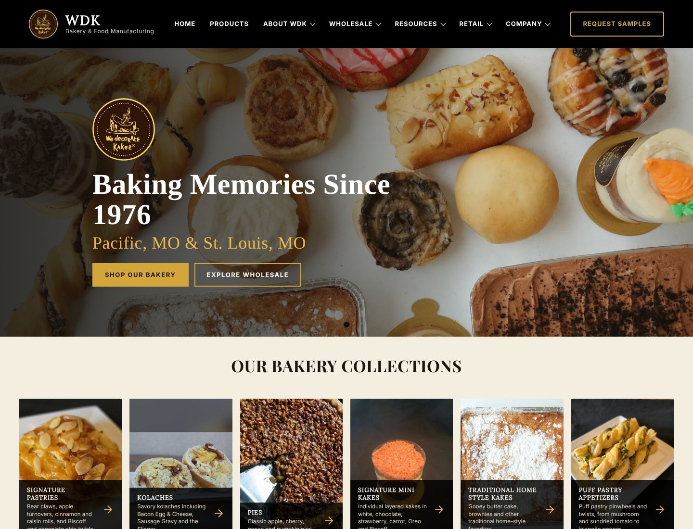
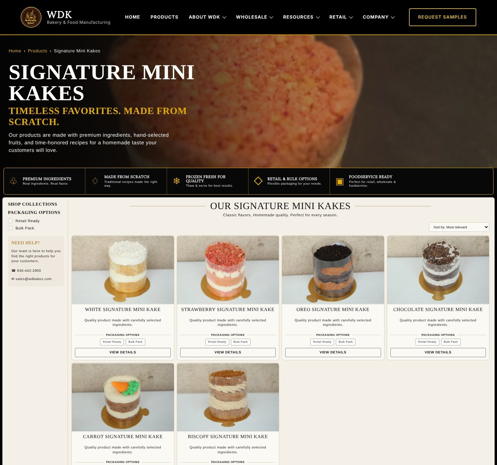
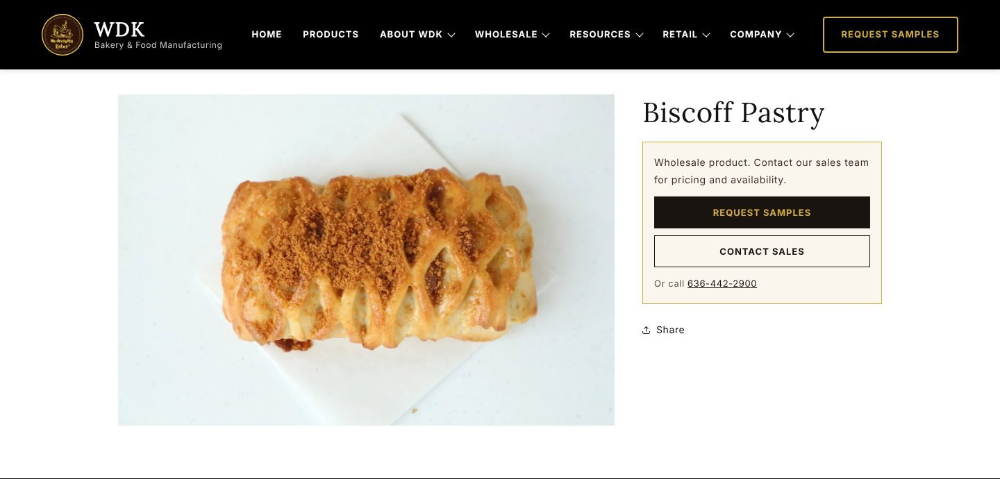
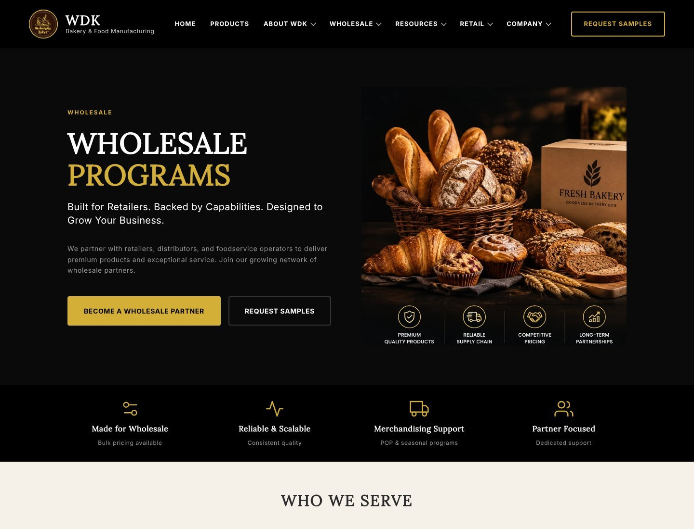
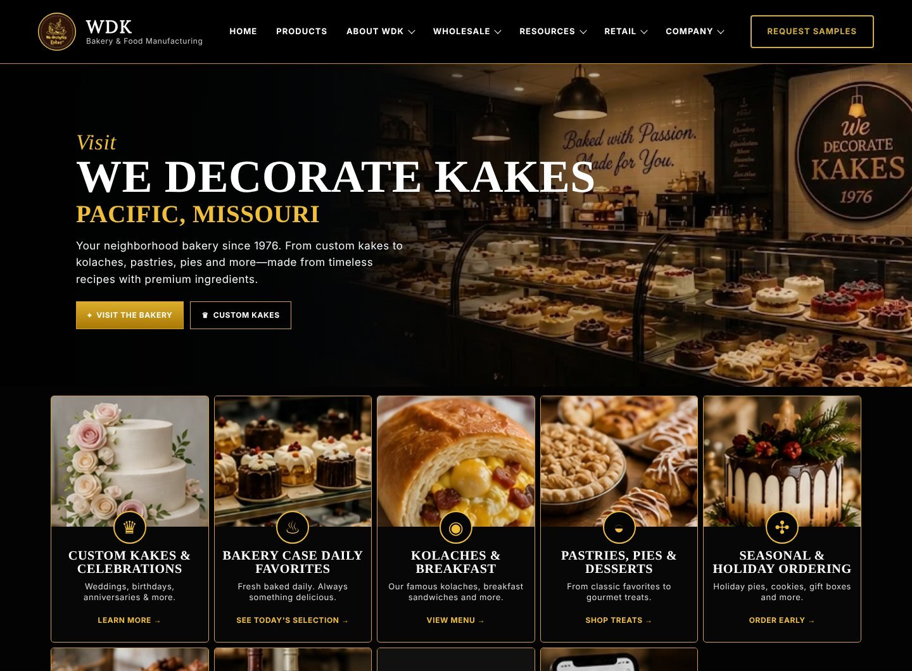
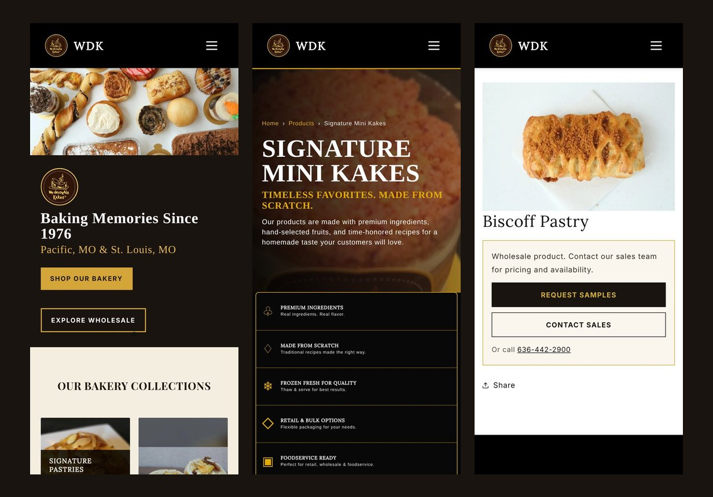

# 🎂 We Decorate Kakes: Shopify Website Showcase

**A retail and wholesale Shopify website I am building for We Decorate Kakes (WDK), a family-owned bakery and food manufacturer in Missouri, USA, baking since 1976.**

<picture></picture>
<picture></picture>

<picture></picture>
<picture></picture>
<picture></picture>
<picture></picture>
<picture></picture>

---

## 📌 About the project

We Decorate Kakes sells through two channels: a **local retail bakery** with in-store pickup, and a **wholesale business** supplying kolaches, pies, pastries, mini kakes and puff-pastry appetizers to grocery, convenience, foodservice and distributor partners.

The client wanted their existing Shopify site rebuilt into a professional **B2B and retail website**. The site needed to:

- present the full product range clearly, using real product photography
- support wholesale buyers with sell sheets, merchandising resources and sample / sales request forms, with no public wholesale pricing or cart
- offer retail pickup ordering
- include a Bakery Knowledge Center, seasonal programs and the company story
- follow strict brand rules: the original heritage logo, real photos only, and no unverified claims

I am responsible for the **theme development, page builds, forms, SEO, QA and launch preparation** for Phase 2 of the project.

---

## ✨ Features

| Area | What I built |
|---|---|
| 🏠 **Homepage** | A rebuilt hero with the heritage logo, "Baking Memories Since 1976" and **Shop Our Bakery / Explore Wholesale** buttons, a dedicated mobile layout, and bakery collection cards using real product photos |
| 🗂️ **Product catalog** | A product catalog page with product-family cards, and collection pages with category banners |
| 🖼️ **Photo override** | A theme-level system that swaps in the new studio photography on collection grids, product cards and product pages without editing store data |
| 🛒 **Two product templates** | **Wholesale:** no price or cart, with Request Samples / Contact Sales buttons and spec fields driven by metafields. **Retail:** price, variants, buy buttons and a local pickup notice |
| 📚 **Bakery Knowledge Center** | 6 topic categories, 37 articles, 6 downloadable guides, on-page search and an Ask the Experts form |
| 📄 **Downloads & sell sheets** | A downloads page with 14 PDF sell sheets plus the product catalog; rows without a real file hide automatically, so there are no dead buttons |
| 🎉 **Content pages** | Wholesale Programs, Retail Success Center, Seasonal Programs, Custom Kakes and more, with content and link fixes |
| ✉️ **Forms** | About 11 inquiry forms (wholesale, request samples, contact sales, custom kakes, catering quote, private label, careers and more) moved to native Shopify forms, with subject tagging, confirmation messages and error handling |
| 🔍 **SEO** | Brand-name fixes in titles and meta tags, and LocalBusiness / Bakery **structured data (JSON-LD)** for local search |
| 🧪 **QA** | Automated desktop and mobile screenshots and link testing with Playwright |
| 📱 **Responsive** | Layouts tuned for phones, tablets and desktop |

---

## 🖼️ Screenshots

### Home

### Collection: Signature Mini Kakes

### Wholesale product page

### Wholesale Programs

### Custom Kakes: visit the bakery

### Mobile

> Some pages are left out of the screenshots on purpose because they show the owners' family details or photos that are only approved for the client's own website.

---

## 🛠️ Tech stack

- **Platform:** Shopify Online Store 2.0, with a custom Dawn-based theme
- **Theme development:** Liquid, JSON templates, sections and blocks, alternate templates, product metafields, JavaScript and CSS
- **Tooling:** Shopify CLI (`theme push`, `theme check`), Git and GitHub
- **Automated QA:** Playwright (headless Chromium) for desktop and mobile screenshots and link testing
- **Asset preparation:** Python (Pillow for image processing)

---

## 🧭 My process

1. **Discovery:** worked from the client's Phase 2 handoff package, brand rules and approved product photography.
2. **Build:** developed everything on an unpublished development theme, so the live store was never affected.
3. **Wholesale vs retail:** kept the two channels clearly separate in templates, navigation and buttons.
4. **Forms & content:** moved every inquiry form to native Shopify forms and built the content pages.
5. **QA:** tested every visible link, button and form on desktop and mobile with automated screenshots.
6. **Launch prep:** prepared product import files and a domain launch checklist.

---

## 🚧 Status

**In progress.** Phase 2 development is complete on the development theme and is awaiting final owner review and launch.

---

## 🔒 Why there's no source code here

> [!IMPORTANT]
> **This is a showcase repository. It contains only screenshots and this write-up.**
>
> We Decorate Kakes is a **real client project**. The client owns the theme code, and it is kept in a **private repository** because it contains:
> - the client's business content, product data, photography and branding assets
> - store configuration and deployment settings
> - internal project documents from the client
>
> Making that repository public would expose the client's data, so I keep it private. This repo explains what I built and how.

---

## 👨‍💻 Author

**Jamshaid Khan Niazi**, web developer

- 🌐 Portfolio: [jamshaidkhanniazi5965-ship-it.github.io](https://jamshaidkhanniazi5965-ship-it.github.io)
- 💼 GitHub: [@jamshaidkhanniazi5965-ship-it](https://github.com/jamshaidkhanniazi5965-ship-it)

---

© We Decorate Kakes. The brand, logo, photos and content belong to the client and are shown here for portfolio purposes only. The source code is not included.

